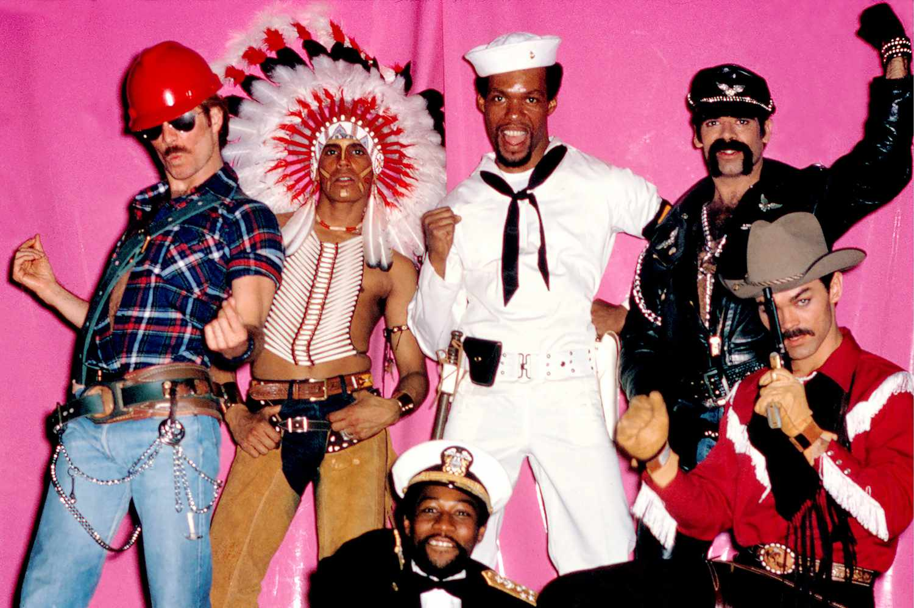
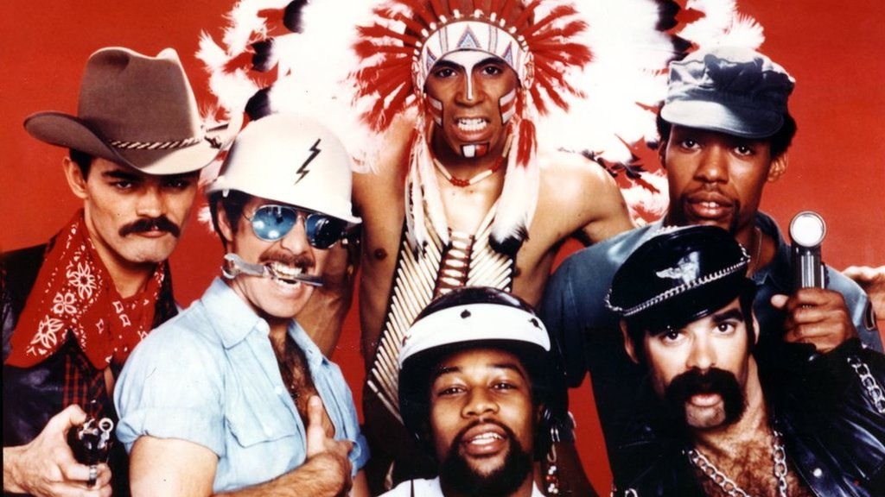
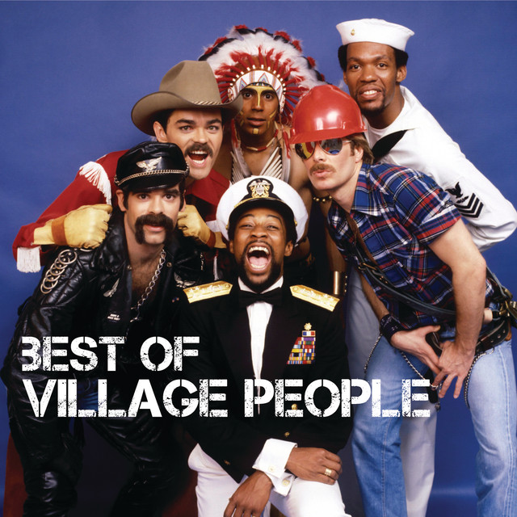
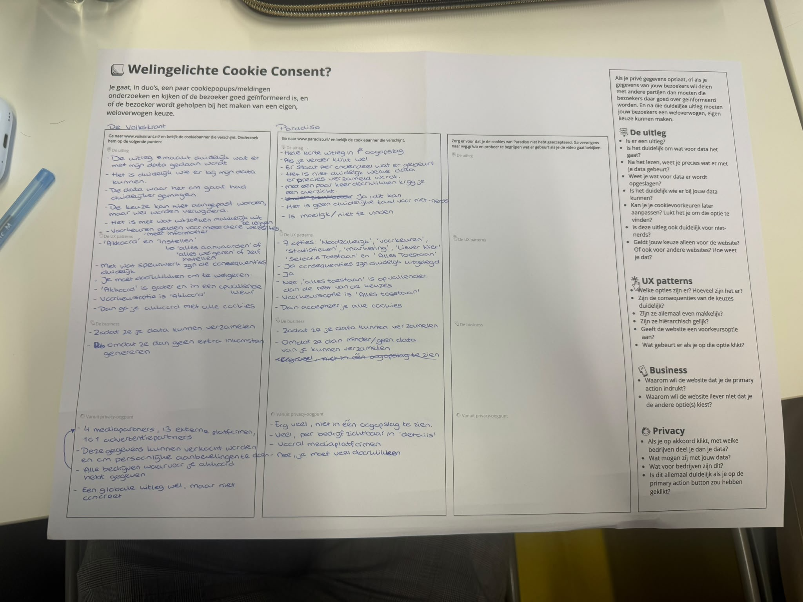
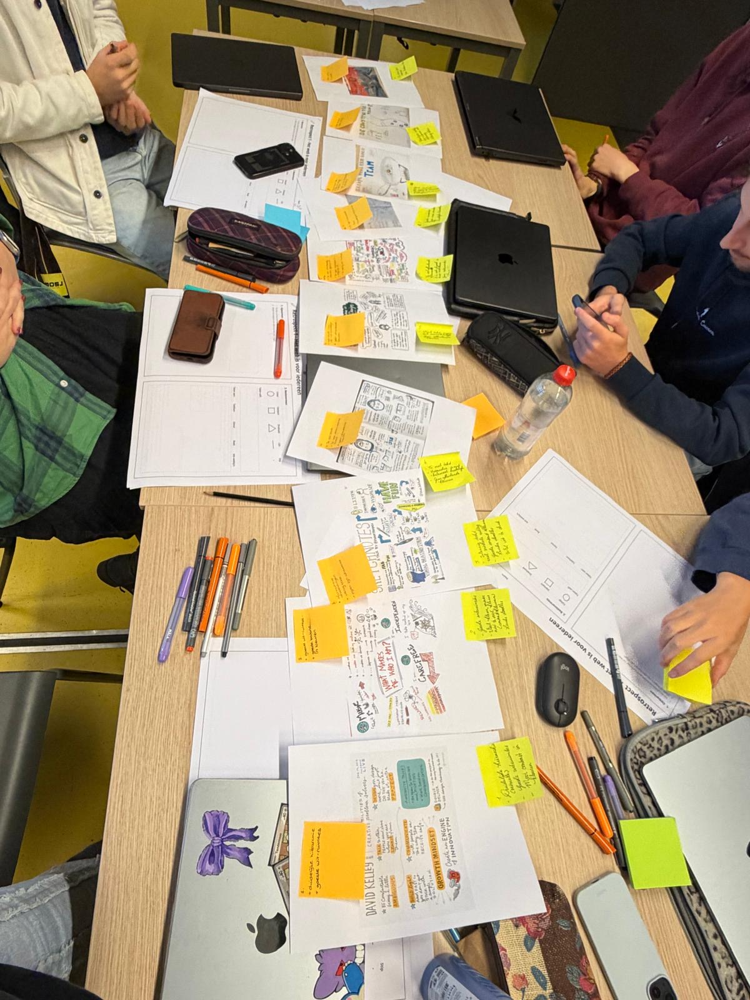
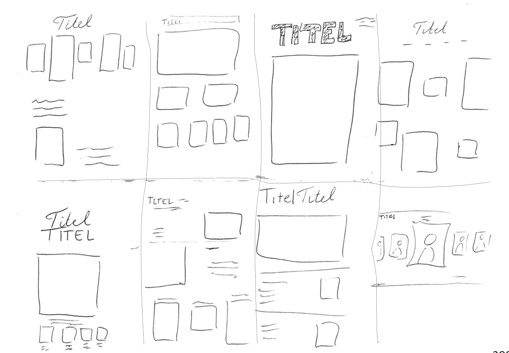

# Model

Het staat model voor digitale tuintjes welke bij 'Het web is voor iedereen' door studenten worden gemaakt.

## Learning Log

# Reflectie op het blok:

Ik heb in dit blok ontzettend veel geleerd, vooral over code. Het meeste was nieuw voor me, dus het ging af en toe best snel en soms moest ik even zoeken, maar ik merkte dat ik het eigenlijk heel leuk vind om te doen. Door dingen gewoon uit te proberen, de deep dives te doen en te bouwen kwam ik erachter wat werkte. Als ik mijn website nu opnieuw zou moeten maken denk ik dat het een stuk sneller zou gaan, omdat ik nu veel beter snap hoe de onderdelen samenwerken.

Ik ben redelijk tevreden met mijn website. Als ik nu naar de laatste versie kijk, snap ik de feedback die ik onderweg heb gekregen beter en vind ik hem ook echt waardevol. In het begin kwam het idee van een galerij nog niet goed over, ook al was het in mijn hoofd duidelijk. Door de feedback heb ik de indeling en de stijl aangepast, en nu lijkt mijn website veel meer op een galerij. Dat is precies wat ik wilde laten zien.

Ook denk ik dat ik uiteindelijk stappen heb gemaakt met mijn songtekst. In het begin had ik wat moeite om hem 'lelijk' te maken zoals Diederik en Sanne zeiden, maar ik denk dat het uiteindelijk na aanpassing maken met de feedback wel beter gelukt is.

Wat ik hieruit meeneem, is dat feedback me echt verder helpt en dat een idee dat voor mij duidelijk is, dat voor een bezoeker nog niet hoeft te zijn.

# 26 oct [Expo]

Learning Log compleet:

Samen met medestudenten heb ik gekeken hoe compleet mijn learning log is. Bijna alle opdrachten staan erin en de visual thinking-opdrachten zien er goed uit, maar er staat nog geen uitleg bij. Alleen de eerste metafoor-opdracht mist nog. Mijn check-outs staan erin, maar mijn eigen proces mag duidelijker in beeld komen. Mijn schetsen zijn duidelijk, maar bij een aantal ontbreekt nog de omschrijving. Het geheel is netjes, met een duidelijke datum en titel bij elk stuk. Mijn bronnen moet ik nog vermelden, bijvoorbeeld bij mijn CSS-code. Dat ga ik nu aanvullen.

Webby?:
Ik vond het fijn om nog even met een medestudent zo nauwkeurig door mijn website te lopen. We hebben hem getest op een telefoon en daar bleef de tekst goed leesbaar, ook de light en dark versie werkte. De knoppen waren groot genoeg om met je vingers te bedienen en de paragrafen hebben een goed formaat. Over de interactie zeiden we dat de hover goed werkt en dat de knoppen doen wat ze moeten doen. Ik gebruik weinig animaties, maar de animaties in de songtekst werken goed. De knop om terug te gaan van de songtekst naar de hoofdpagina is duidelijk, en bij het scrollen blijft duidelijk dat je op dezelfde pagina zit.
Voor toegankelijkheid zagen we dat het contrast goed is en dat de hiërarchie duidelijk is, omdat de twee lettertypes laten zien wat de titels zijn. Met een screenreader was de tekst redelijk goed te lezen. Ik moet nog even kijken hoe het toetsenbord werkt zonder screenreader. Mijn cookie-melding is duidelijk: je wordt gewaarschuwd over data van GitHub en je kunt naar het privacybeleid van GitHub. De pagina is ook zonder iets te accepteren te gebruiken.
Verder zagen we dat ik geen gradiënten gebruik en dat de layout en typografie goed bij mijn concept en onderwerp passen. Als tip bedachten we dat ik misschien de kleur van de blokken kan veranderen, bijvoorbeeld naar bruin. Ik vond het fijn om te zien dat het idee van een kunstgalerij nu beter overkomt en dat de website duidelijk is. Dat was in eerdere feedback nog een probleem.
Wat ik hieruit meeneem: de basis staat goed. Ik ga nog testen hoe mijn website werkt met alleen een toetsenbord en ik kijk of een andere kleur voor de blokken beter werkt.

- Ik heb het toetsenbord later nog een keer getest. Ik had de instellingen van mijn toetsenbord op mijn laptop niet goed staan, dus daarom werkte het niet. Nu kan ik wel goed met alleen het toetsenbord door mijn website heen.
  

Feedback expo:
Tijdens de expo hebben mijn medestudenten feedback op mijn digital garden achtergelaten met stickers en kleine tekstjes. Ik werd blij van de reacties op het ontwerp. Ze vonden de site rustig, met de focus op mijn eigen werk, en zeiden dat mijn tekeningen er mooi uitkomen. Dat is wat mij eerst nog niet helemaal gelukt was, dus ik ben blij dat het nu wel goed overkomt. Dat is precies wat ik wilde bereiken met het galerij-idee. Ze vonden de hiërarchie van mijn grid leuk en onverwacht, en ze vonden het fijn dat ik verschillende grids op één pagina gebruik. Eén medestudent zei dat het handig is dat ik mijn proces stap voor stap laat zien. Er werd ook gezegd dat mijn site goed werkt op een klein scherm, met een menu dat prettig te gebruiken is.

Ik leer hieruit dat mijn keuzes nu uiteindelijk wel werken: veel wit, de tekeningen centraal en een grid met verschillende groottes. Er stond geen kritiek op de briefjes, dus als ik nog iets wil verbeteren, moet ik zelf kijken wat dat is. Dat wordt voor mij als het nog lukt om te kijken of ik een decline optie kan maken in de cookie pop-up.

# 23 oct [Werkgroep 18]

Schetsen na feedback:

Deze schets heb ik gemaakt na de feedback.
Bovenaan staat de titel “In de Galerij” met daaronder een blokje tekst. Daaronder hangen de portretten groot en los van elkaar, zoals schilderijen aan een muur, met genoeg wit eromheen. Ze hebben niet allemaal precies dezelfde grootte. Boven elk portret zitten twee lampjes, zodat het lijkt alsof er licht op de tekening valt. Naast elk portret zit een klein bordje met een paar regels tekst, net als in een museum waar naast een schilderij een bordje hangt met uitleg. Zo staat de tekst niet meer los van de tekening, maar hoort hij erbij.
Ik verwacht dat de website hierdoor meer op een galerij gaat lijken, omdat de portretten de aandacht krijgen en de tekst er rustig naast staat.

- Daarnaast heb ik ook de schilderijen aangepast na de feedback. Ik heb ze bijgesneden en recht getrokken en bij elk schilderij een lijst erom gemaakt. Zo hoop ik dat het ook meer op een galerij gaat lijken.

feedback:
De feedback die ik van Diederik gekregen heb is dat het idee goed is van de galerij, maar dat het nog steeds niet helemaal naar voren komt. Dus ik moet gaan kijken hoe ik het nog meer op een galerij kan laten lijken. Daarnaast zou het het zijn als ik voor mijn cookies pop-up ook een decline optie maak met dat je naar een andere pagina gaat, of je delen van mijn pagina niet meer kan zien, etc. Mijn songtekst was wel redelijk goed. De twee kolommen zijn alleen nog wat statisch. Ik kan bijvoorbeeld de kolommen gestaffeld plaatsen. Ik kan ook nog wat meer doen met de poppetjes die ik heb getekend.

Retrospective:

Voor mijn metafoor heb ik een tekening gemaakt van mezelf als een stil figuur, terwijl de wereld om me heen in een waas voorbijrent. De titel is Voorbij voor ik het weet. Het beeld laat het gevoel zien dat alles tegelijk komt en snel gaat: opdrachten, deadlines en verwachtingen rennen langs me heen voordat ik er grip op heb. Ik heb de letters in de titel steeds kleiner en dunner gemaakt, zodat ook de tekst vervaagt. Alleen het woord ik staat er scherp en dik. Dat gevoel kwam vooral doordat ik door mijn ziekte achterliep, waardoor alles tegelijk op me af kwam.

De titel past ook op een positieve manier bij het blok. Het ging namelijk ook snel voorbij, omdat ik veel bezig was met code en er veel nieuw was om te leren. Ik heb in deze weken veel geleerd en veel met code gewerkt, en dat vond ik uiteindelijk vooral leuk.

# 19 oct [Werkgroep 16]

Ik ben nog niet helemaal tevreden met mijn ontwerp. Ik wil nog meer toevoegen en dingen afmaken. Zo wil ik de website interactiever en interessanter maken, bijvoorbeeld door de portretten zo neer te zetten alsof het licht erop valt en ze aan een muur hangen. Ook wil ik nog aanpassingen maken aan mijn songtekst, zodat hij meer lijkt op het originele nummer.

## 09 oct [Werkgroep 15]

Aanpassingen songtekst na feedback:

Na de feedback heb ik poppetjes getekent die ik ga gebruiken in plaats van de YMCA letter. Hiervoor heb ik de echte band leden geprobeerd na te tekenen.

Daarnaast heb ik foto's van de band gebruikt om een kleuren thema te maken:

Ik ben uiteindelijk dus gegaan voor een combinatie van rood, blauw en roze.

check-out

1.  Welke variabelen van Seraphs gebruik ik?
    Ik gebruik wght en SRFS, ingesteld met font-variation-settings. Het gewicht varieert van 100 voor gewone tekst (p, said, h1, h2) via 122 voor “down” en “ground” en 140 voor “unhappy”, “stay” en “many ways to have a good time”, tot 200 voor “Young man”. SRFS staat meestal op 0, bij de songtekstregels (p) op 4 en bij “I said” op 44.

2.  Wat voegt iedere variabele toe?
    Het gewicht zorgt voor hiërarchie. Tekstregels zijn dun en rustig, terwijl “Young man” en de accentwoorden zwaarder zijn en meteen opvallen. Samen met de kleur (roze, blauw) en de grotere letters (--step-3) bepaalt het wat je als eerste leest. SRFS geeft karakter: de bijzin “I said” krijgt een heel andere vorm (44) dan de rest, zodat het als een soort fluistering tussen de regels staat. Door SRFS laag te houden bij de lopende tekst blijft die goed leesbaar, en de extreme waarden bewaar ik voor de accenten.

3.  Hoe kan ik animatie gebruiken om ritme en accenten beter zichtbaar te maken?
    Nu beweeg ik met transform (“down” zakt, “ground” kruipt omhoog) en laat ik de YMCA-poppetjes groeien bij hover

feedback gesprekje:
Songtekst mag nog een stuk lelijker. Het is nu bijna een ouderwetse stijl. Past niet echt bij het nummer. YMCA is een beetje cringe, dys ik moet dat laten zien in mijn songtekst. Moet ook kijken naar hoe ik het lettertype gebruik.

## 07 oct [Werkgroep 14]

check-out

1. Grid
   Ontwerper: een grid geeft houvast. Ik hoef niet bij elk element opnieuw te bedenken waar het moet staan, dus ik werk sneller en consistenter.
   Bezoeker: alles staat op een voorspelbare plek. Daardoor leest de pagina rustig en vind je snel wat je zoekt.

2. Chaos voorkomen
   - Ik gebruik een vast systeem voor lettergroottes en marges, zoals een modular scale.
   - Ik beperk mijn keuzes: een paar lettertypes en kleuren, niet tien.
   - Ik lijn elementen uit op dezelfde assen en geef ze genoeg wit.

3. Genoeg om de aandacht te trekken, maar op één of twee plekken. Als alles gek is, valt niets meer op. In mijn YMCA-pagina zit de gekkigheid in de grote letters en de trap, en de rest is rustig. Zo vallen die twee dingen op.

## 05 oct [Werkgroep 13]

check-out

1.  Termen

- Kerning: ruimte tussen twee specifieke letters aanpassen.
- Tracking: letterspatiëring van een hele tekst tegelijk aanpassen.
- Leading: regelafstand, van basislijn tot basislijn.
- Flush-left / flush-right: links / rechts strak uitgelijnd, de andere kant ongelijk.
- Centered: op een middenas uitgelijnd.
- Justified: links én rechts strak uitgelijnd.
- Indent: eerste regel springt naar binnen.
- Outdent: eerste regel steekt naar buiten.
- Modular scale: lettergroottes die met een vaste verhouding groeien.
- Movable type: losse, herbruikbare letters van lood (Gutenberg).
- Focuspunt: het element dat als eerste de aandacht trekt.
- Vijf soorten contrast: grootte, gewicht, stijl/vorm, kleur, richting/positie.
- Spatial tension: spanning door afstand, nabijheid en wit tussen elementen.

2. Ongeveer 60 tekens per regel. Dan lees je lekker door: bij kortere regels moet je steeds naar een nieuwe regel springen, en bij langere regels raak je de weg kwijt.

3. Ik kies grootte. Je ziet meteen wat belangrijk is, zonder dat je erover na hoeft te denken. Plaatsing, spacing en lettersoort zijn subtieler en hebben meer context nodig. In mijn YMCA-pagina zie je het ook: de grote Y-M-C-A letters vallen direct op, en de trap van "many" naar "time" werkt alleen door de groeiende grootte.

## 02 oct [Werkgroep 12]

Feedback van Sanne: Ik kan wat dingen weghalen bij mijn code (figure,article, etc.). Daarnaast moet ik mijn cookie pop-up aanpassen, het mag korter en hoeft alleen maar te gaan over wat de site wel opslaat. Mag omdat het zo weinig informatie nodig heeft ook bijvoorbeeld onderaan de pagina staan en dat je erop moet klikken. Typografie past goed bij mijn onderwerp. Verder moet alles wat ik nog niet gedaan heb door ziekte bijhalen.

Restrospective:

Mijn metafoor voor de tweede sprint is een trein die stilstaat door een storing. Ik was grotendeels ziek, dus de trein staat al anderhalve week stil. In de laatste dagen ben ik weer beter, dus sinds vandaag komt de trein weer een beetje op gang. Dat zie je rechts op de tekening, bij het sein.

### 30 sept [Werkgroep 11]

Check-out

1. Waar staan WCAG en A11y voor?
   WCAG is Web Content Accessibility Guidelines, de internationale richtlijnen voor toegankelijke websites. A11y is een afkorting van accessibility: de a, dan 11 letters, en dan de y.

2. Moet de test nog doen...

### 28 sept [Werkgroep 10]

Bi-weekly geek 2

Check-out

1. Ik denk dat hij bedoelt dat semantiek geen doel op zich is. Je gebruikt het juiste HTML-element niet omdat het netjes is, maar omdat het de gebruiker iets oplevert. Een (button) werkt standaard met het toetsenbord en wordt door een screenreader als knop aangekondigd, en met (h1 t/m h6) en (nav) kun je door een pagina navigeren. Semantiek is dus UX: de gebruiker merkt het zonder dat hij weet dat het semantiek heet.

2. Welke beperkingen hebben invloed op het gebruiken van websites?

- Visueel: blind, slechtziend, kleurenblind.
- Auditief: doof of slechthorend (denk aan ondertitels bij video).
- Motorisch: moeite met een muis of kleine knoppen, of alleen het toetsenbord gebruiken.
- Cognitief: dyslexie, ADHD, concentratieproblemen, waardoor duidelijke structuur en eenvoudige taal helpen.
- Tijdelijk of situationeel: een gebroken arm, fel zonlicht op je scherm, of een trage verbinding.

3. Drie manieren om met een screenreader te navigeren:

- Met de Tab-toets van link naar link, knop en formulierveld.
- Per kop: met de kopjes (h1 t/m h6) spring je door de structuur van de pagina, zonder alles te hoeven voorlezen.
- Via landmarks (zoals nav, main, footer) of een lijst van alle links of koppen, bijvoorbeeld met de rotor van VoiceOver.

### 25 sept [Werkgroep 9]

Check-out

1. HTML-validatie is het controleren van je code met een validator, zoals die van W3C, om te zien of je HTML klopt. Zo vind je fouten als niet-gesloten tags of elementen op de verkeerde plek. Het is belangrijk omdat fouten onverklaarbaar gedrag veroorzaken, browsers ze verschillend oplossen en screenreaders erdoor in de war raken. Vandaag heb ik [mijn code in de validator gezet] en [aantal fouten] verbeterd.

2. De enige echte fout was een afbeelding met spaties in de bestandsnaam, die ik heb aangepast. De info-meldingen gingen over een overbodige slash aan het eind van void elements zoals meta, link, input en img. Die doet niets, dus ik kan hem weghalen.

HTML-validatie:

Ik heb mijn HTML laten controleren met de validator. De meeste meldingen zijn alleen info: de schuine streep aan het eind van sommige elementen heeft geen effect. Dat kan ik weghalen, maar het is geen fout.
Er is wel een echte error. De naam van één afbeelding is niet goed, want er zit een spatie in en dat is niet toegestaan.

### 23 sept [Werkgroep 8]

Check-out

1. Een wireframe is een schematische schets van een pagina waarin ik laat zien hoe die eruit kan komen te zien: welke onderdelen erop staan, waar ze geplaatst worden en wat de interactieve elementen zijn.

Het nut ervan is dat ik snel verschillende layouts kan uitproberen en ideeën kan visualiseren, zonder me al druk te maken over kleur of detail. Dat maakt het makkelijk om ideeën te bespreken en aan te passen voordat ik tijd steek in een uitgewerkt design. Ik kan een wireframe LoFi (snel en simpel) of HiFi (gedetailleerder, bijvoorbeeld in Figma) maken.

2. Volgens NN/G zijn dit ontwerppatronen die gebruikers een actie laten uitvoeren die vooral goed is voor het bedrijf, door ze te misleiden, te sturen, te beschamen of tegen te werken als ze een andere (minder winstgevende) keuze willen maken.Een deceptive pattern is een designpatroon dat gebruikers aanzet tot een actie die het bedrijf ten goede komt, door de gebruiker te misleiden, misleidend te sturen, te beschamen, of tegen te werken bij het maken van een andere keuze. Ze werken vooral goed bij mensen die weinig tijd hebben of minder digitaal vaardig zijn.

Drie voorbeelden zijn:

1.  Obstruction (tegenwerking):
    Het bedrijf maakt het bewust lastig om iets te doen wat niet in hun voordeel is, bijvoorbeeld door opzeggen heel omslachtig te maken.
2.  Confirmshaming (emotionele manipulatie):
    Als je iets weigert (zoals een kortingscode), krijg je een schuldgevoel-tekstje te zien in plaats van een neutrale "nee, bedankt"-knop, zoals "nee, ik hou niet van besparen".
3.  Sneaking / preselection (stiekem toevoegen):
    Bij het afrekenen worden er automatisch extra items aan je winkelwagen toegevoegd, of extra opties alvast aangevinkt, zonder dat je dat zelf hebt gekozen. Jij moet het dan zelf ontdekken en uitzetten.

4.  Bij een human consent component moet ik als ontwerper vooral zorgen dat de gebruiker een eerlijke, vrije keuze heeft. Dat betekent dat weigeren net zo makkelijk moet zijn als accepteren, dat er niks alvast voor de gebruiker wordt aangevinkt, en dat ik geen schuldgevoel of tijdsdruk gebruik om iemand richting "ja" te duwen. Ook moet de tekst kort en duidelijk zijn, zodat iemand echt snapt waar diegene mee instemt, en moet die keuze later ook weer aan te passen zijn.

### 21 sept [Werkgroep 7]

Check-out

1. HTML Landmark Role Elements zijn elementen die de hoofdstructuur van een pagina aangeven. Denk aan: (header,nav en main). Ze maken duidelijk welk deel van de pagina waarvoor dient.

2. Heading elementen zijn (h1 t/m h6) gebruikt om koppen en subkoppen aan te geven. Ze horen "genest" te worden: eerst één (h1) als hoofdtitel, daarna (h2) voor secties, daaronder (h3) voor subsecties, enzovoort, zonder niveaus over te slaan. Zo kun je met screenreaders snel door de structuur van de pagina navigeren, net als een inhoudsopgave.

3. Vroeger (op de middelbare school) drukte ik eigenlijk meteen op accepteer alles, omdat ik geen idee had wat cookies deden. Tegenwoordig heb ik veel meer over geleerd en zoek ik eigenlijk meteen naar de weiger alles knop. Zelfs als ik er wat meer moeite voor moet doen door alle voorkeuren weg te klikken.

Na de feedback van vrijdag heb ik een aantal layout schetsen gemaakt:

De feedback was dat mijn website nog niet echt op een galerij leek. Daarom heb ik schetsen gemaakt om te kijken wat werkt voor het galerij-idee.

### 18 sept [Werkgroep 6]

Oriënteren en begrijpen:
Ik koos voor een digitaal tuintje met portretten in de vorm van een kunstgalerij. In het feedbackgesprek bleek dat de docent dat idee snapte, maar dat ik het nog beter moest laten zien. Ik weet nu dat een idee dat in mijn hoofd duidelijk is, voor een bezoeker nog niet vanzelf duidelijk is.

Verbeelden en conceptualiseren:
Ik begon met een kunstenaarswebsite als voorbeeld, waarin schilderijen als collage naast de tekst staan. Na de feedback zocht ik een museum als referentie. Daar hangen de schilderijen los naast elkaar, in verschillende groottes, met een titel eronder en een bankje op de vloer. Zo ging ik van een site met schilderijen naar een ruimte waar je langs schilderijen loopt.

Prototypen en uitwerken:
Ik heb schetsen gemaakt voor de layout op laptop en telefoon en daarna alles in code gebouwd. Door te bouwen kom ik erachter wat werkt, bijvoorbeeld bij het layouten met grid-template-areas, het hamburgermenu met een dialog en de procespagina over één schilderij. Technieken leer ik het best door ze toe te passen.

Evalueren:
Wat wilde ik weten? Of mijn layout het galerij-idee overbrengt. Wat deed ik? Ik liet mijn eerste versie zien in het feedbackgesprek. Resultaat? De code was goed en de stijl paste bij mijn onderwerp, maar de schilderijen moesten echt los op de pagina staan. Wat weet ik nu (niet)? Ik weet dat de indeling net zo belangrijk is als de stijl, maar ik weet nog niet of het galerij-gevoel ook goed werkt op een telefoon. Ik moet nog checken: HTML-validatie, toegankelijkheid (alt-teksten, contrast, toetsenbord), light/dark mode en prefers-reduced-motion.

Retrospect 1:

Mijn metafoor voor de eerste sprint is een skiër op een afdaling. Ik begin net aan het tweede jaar en ben de HTML van vorig jaar een beetje vergeten. Bij de start is het daarom rustig en zonder obstakels. Aan het einde van de eerste weken komt er steeds meer informatie bij. Op de tekening zie je dat aan de bomen onderaan, die steeds dichter op elkaar staan. Bij de finish sneeuwt het, is er veel te doen en zijn er veel obstakels.

### 16 sept [Werkgroep 5]

1.  3 principes
    Nabijheid: Dingen die bij elkaar horen, staan dicht bij elkaar.
    Gelijkenis: Elementen met dezelfde kleur of vorm voelen alsof ze bij elkaar horen.
    Figuur en achtergrond: Het belangrijkste onderdeel valt op tegen de achtergrond.

2.  Een grid geeft je houvast en zorgt dat alles netjes bij elkaar past. Toch kun je binnen dat grid spelen met de grootte en plek van afbeeldingen. Het ontwerp blijft daardoor overzichtelijk, maar niet saai.

3.  Ik wil het principe nabijheid gebruiken. Ik zet afbeeldingen en tekst die bij elkaar horen dichter bij elkaar. Zo wordt mijn Garden duidelijker en krijgt het meer de sfeer van een kunstgalerij.

### 14 sept - [Werkgroep 4]

Bi-weekly geek 1

In een groepje met Judith, Seb en Massimo hebben we deelvragen bedacht bij de hoofdvraag Moeten kritieke internetdiensten commerciële bedrijven zijn? Daarna hebben we onderzoeksmethodes gekozen voor de deelvragen van een ander groepje, bijvoorbeeld een literature study of een interview. Ik leer hierdoor dat je een grote vraag eerst opdeelt in kleinere vragen, en dat je de onderzoeksmethode kiest op basis van wat je wilt weten.

Check-out

1. Een website wordt lelijk als hij niet responsive is, bijvoorbeeld dat alles verspringt op een mobieltje. Wat je eraan kunt doen is zorgen dat je de code ook test in mobiel formaat en aanpassingen maakt, zodat er niks verspringt. Daarnaast is een rommelige indeling niet mooi. Dit zorgt er namelijk voor dat de website niet toegangkelijk is voor bezoekers. Wat je eraan kan doen is met een duidelijke visuele hiërarchie werken. Als laatste zijn te veel animaties niet mooi. Animaties zijn leuk en interessant voor de website, maar wel met mate. Te veel animaties leidt af van de inhoud van de website. Gebruik animaties alleen wanneer ze iets toevoegen.

2. De volgende stap die ik ga zetten om mijn website responsive te maken is zorgen dat hij zich goed aanpast aan verschillende scherm formaten.

3. Mijn Garden is ontworpen in de stijl van een online kunstgalerij. Ik heb gekozen voor een rustige achtergrond, opvallende kleuren en veel witruimte, zodat de afbeeldingen en kunstwerken centraal staan. Met HTML heb ik de structuur gemaakt en met CSS de lay-out, typografie, kleuren en navigatie vormgegeven. De eenvoudige navigatie en duidelijke visuele hiërarchie zorgen voor een overzichtelijke user experience.

Wat ik uit de voorbereiding haal is dat de samenleving ontzettend afhankelijk is van grote cloudbedrijven als Amazon. Als een van deze bedrijven uitvalt heeft dat grote gevolgen. Daarnaast zijn europese landen te afhankelijk van Chineese en Amerikaanse technologie bedrijven. Het is belangrijk dat Europa meer onafhankelijk wordt van buitelandse bedrijven.

### 12 sept - [Werkgroep 3]

De feedback die ik vandaag van Justus heb gekregen is dat het idee van portret tekenen heel leuk en persoonlijk is. Ik moet nu gaan bedenken hoe ik het ga uitwerken in html. Hij gaf mij bijvoorbeeld het idee om de achtergrond van de webpagina een soort werkplek te maken, dat je de potloden kan zien liggen en dan de tekeningen erin plaatsen. Maar ik moet er verder nog goed over nadenken en gewoon gaan proberen.

### 10 sept - [Werkgroep 2]

Onderzoek:

Ik heb layouts van kunstgalerijen opgezocht om een sfeerimpressie te krijgen en inspiratie op te doen. Ik wil zien hoe kunstwerken in een galerij worden gepresenteerd, zodat ik dat kan vertalen naar mijn eigen website met portretten. Ik let vooral op de indeling, de witruimte en hoe de kunstwerken de aandacht krijgen.

Check-out

1. vraag 1: Je begint met onderzoek, beelden verzamelen en inspiratie opdoen. Daarna ga je kijken welke beelden het meest relevant zijn. Daarna maak je van je onderzoek een duidelijk idee voor het ontwerp.

2. Mijn digital garden gaat over portret tekenen. Ik doe het over dit oinderwerp omdat het iets is wat ik zelf heel leuk vind om te doen en daarom kan ik mijn digital garden heel persoonlijk maken. Ik wil mijn digital garden vormgeven als een soort kunst galerij. Met daarin foto's van mijn eigen portretten en misschien ook van andere mensen. Als je op de foto klikt komt er een klein tekstje over de tekening.

3. Ik zou van de crazy 8 de eerste (links boven) uit willen werken. Ik denk namelijk dat dit een design is dat bruikbaar is voor laptop, maar ook nog goed eruit ziet op telefoon formaat. Daarnaast geeft het een beetje de sfeer van een galerij.

   

### 7 sept - [Werkgroep 1]

Check-out

1. Een digital garden is een online plek waar iemand ideeën deeld over een onderwerp dat diegene aanspreekt. Een digital garden is nooit af. Er kunnen altijd nieuwe ideeën bijkomen. Pagina's worden aan elkaar gekoppeld op basis van inhoud en onderlinge verbanden. De schrijver heeft geen authoriteit en kan fout zitten en zijn mening veranderen.

2. Wat naar mijn idee een website webby maakt is dat er een structuur inzit die herkenbaar is voor de doelgroep, maar dat er ook verassende dingen in de website zitten die het interessant maken. Daarnaast is de typografie, hyrarchie en het contrast super belangrijk. Als bijvoorbeeld de contrasten tussen de kleuren heel slecht is zullen mensen je website minder snel lezen.

3. Ik ben er nog niet helemaal over uit welk onderwerp ik voor mijn digital garden ga gebruiken. Ik denk wel dat ik het over een hobby wil doen, wat dat geeft mij plezier en daar kan ik veel over kwijt. Waar ik nu tussen zit te twijfel is realistisch teken, skieën of hockeyen.

### 3 sept - [Workshop]

Het handigste wat ik bij de deepdive HTML & CSS Basics (Justus) geleerd heb is
dat alles werkt doordat een website geopend wordt dan een http request verzonden wordt
dat request wordt naar de server gestuurd en dan wordt de website geladen. Ik was verast dat de request meerdere keren verzonden moet worden voordat de website met de stijl die er gekozen is geladen is.

### 31 aug - Kickoff

Check-out
Een fork van de model repository gemaakt en gepubliceerd via mijn eigen Github omgeving.

1. Ik heb voor github gekozen als source hosting platform.

2. Ik heb voor tuintjevaneva als domein naam gekozen. Ik heb die gekoppeld door de stappen in dlo te
   volgen.

3. Je kan aanpassingen maken aan mijn pagina door de code aan te passen in vscode.

## S1 - Light & Dark theme (Vasilis)

Van de deep dive heb ik geleerd hoe je met CSS custom properties een light en dark theme maakt. Je zet je kleuren één keer als variabelen en past ze aan voor het andere thema, dat scheelt veel dubbel werk.
Op mijn website van Eva de Ruig heb ik dit toegepast met een keuze tussen “licht” en “donker” in de navigatie, zodat bezoekers zelf kunnen kiezen wat ze prettig vinden.
